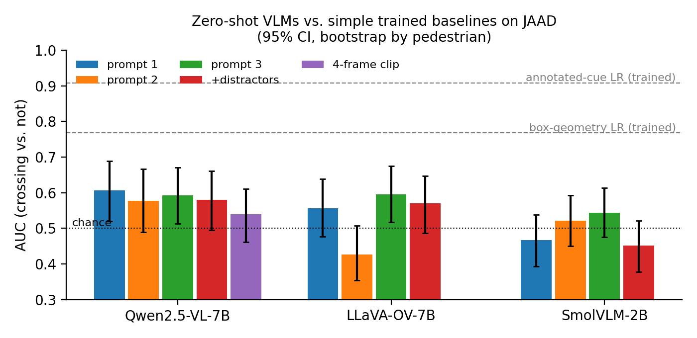
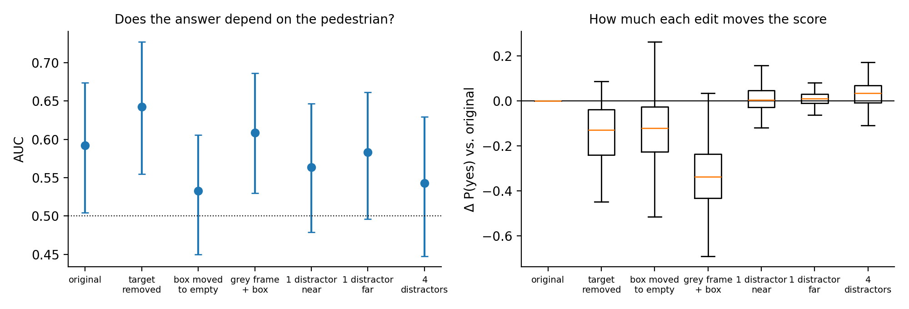
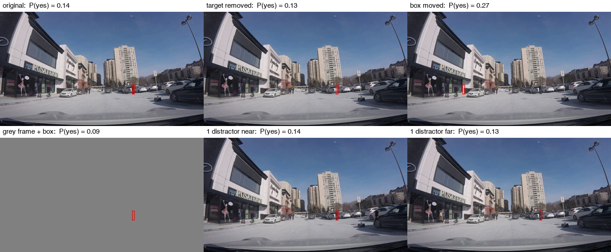
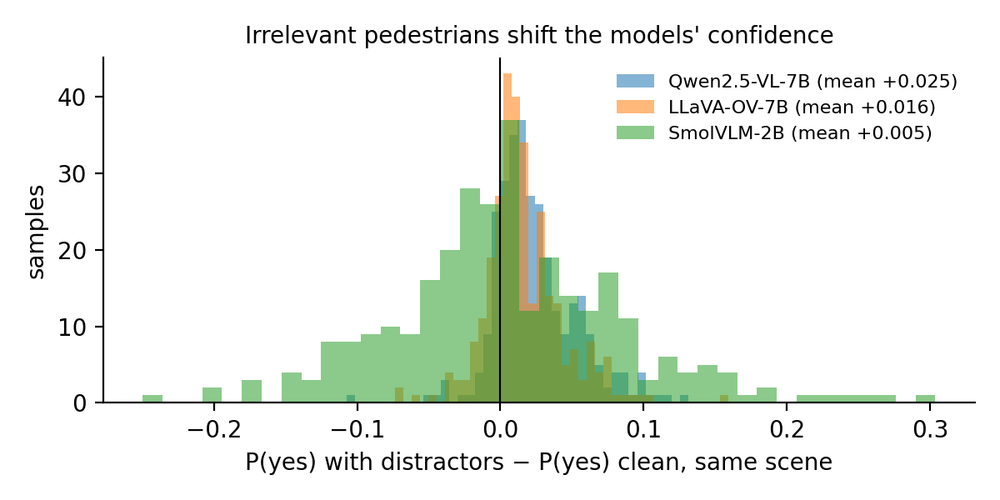
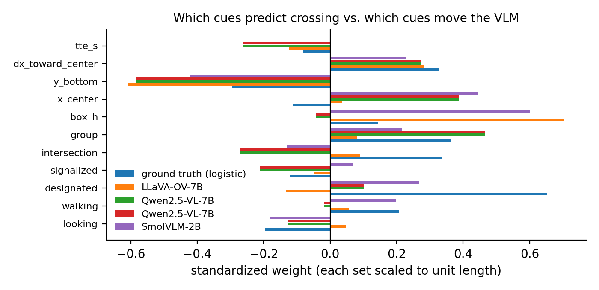

# Results

300 JAAD samples (150 crossing / 150 not), 174 pedestrians. All 95% CIs come from a cluster bootstrap over pedestrians. Run 2026-10-13 on Kaggle 2×T4, fp16, transformers 4.57.

## 1. Zero-shot VLMs barely predict crossing intent

| Model | AUC prompt 1 | AUC prompt 2 | AUC prompt 3 | "Yes" rate across prompts |
|---|---|---|---|---|
| Qwen2.5-VL-7B | **0.606** [0.52, 0.69] | 0.577 | 0.592 | 0% / 7% / 22% |
| LLaVA-OV-7B | 0.556 | **0.426** | 0.595 | 10% / **91%** / 62% |
| SmolVLM-2B | 0.466 | 0.521 | 0.544 | 6% / 62% / 13% |
| *Box-geometry logistic regression (trained, 5 features)* | *0.768* [0.69, 0.84] | | | |
| *Annotated-cue logistic regression (trained, 11 features)* | *0.908* [0.85, 0.95] | | | |

- The best zero-shot result is about 0.60 AUC. All three models sit close to chance, and none comes near a 5-feature linear model on box position.
- **Prompt wording changes how often the models say "Yes" far more than it changes their ranking.** LLaVA goes from 10% to 91% "Yes" when the prompt is reworded, and with prompt 2 its ranking falls *below* chance (0.43). Qwen keeps a consistent ranking across prompts (Spearman 0.77–0.85) but almost never answers "Yes" with prompt 1.
- **Showing four frames instead of one doesn't help** (Qwen: 0.54 vs. 0.61).

## 2. The signal does not come from the pedestrian (Qwen2.5-VL-7B, prompt 3)

Each edited image is compared with the same original image, in the same model run.

| Edit | AUC | ΔAUC vs. original | Mean ΔP(yes) | Spearman vs. original |
|---|---|---|---|---|
| original | 0.592 | — | — | 1.00 |
| **pedestrian inpainted out** (box kept) | **0.642** | +0.050 [−0.02, +0.12] | −0.149 | 0.60 |
| box moved to empty pavement | 0.533 | −0.059 [−0.14, +0.02] | −0.124 | 0.43 |
| **grey frame + box only** | **0.609** | +0.017 [−0.09, +0.12] | −0.332 | −0.01 |
| 1 distractor, near | 0.564 | −0.029 [−0.07, +0.01] | +0.015 | 0.85 |
| 1 distractor, far | 0.583 | −0.009 [−0.03, +0.01] | +0.011 | 0.97 |
| 4 distractors | 0.543 | −0.026 [−0.07, +0.02] | +0.036 | 0.83 |

- **Removing the pedestrian does not hurt discrimination.** AUC stays the same or rises slightly (0.59 → 0.64). If the model were reading the person's pose, gaze or motion, painting them out should lower its AUC toward chance. It doesn't.
- **A grey frame containing only the red box does as well as the real scene** (0.61 vs. 0.59). Whatever weak signal the model has, the box's location in the frame accounts for all of it. That matches the trained geometry baseline (0.77), which shows box position alone is informative on JAAD.
- The scene does affect the *absolute* score: an empty or blank frame lowers P(yes) by 0.12–0.33. So the model uses the image to set how likely "Yes" is overall, but not to tell crossers from non-crossers.
- Moving the box to empty pavement changes the score most (Spearman 0.43), which is consistent with the model relying on where the box is.

*Example: a pedestrian who does cross. P(yes) is 0.14 with the person present and 0.13 with the person removed.*

## 3. Irrelevant pedestrians move the score, and nearer ones move it more

- Distractors shift P(yes) **upward**. For Qwen, every condition's shift is significant: near +0.015 [+0.005, +0.025], far +0.011 [+0.006, +0.015], four distractors +0.036 [+0.026, +0.046], two distractors in the main run +0.025 [+0.021, +0.028]. LLaVA shows the same: +0.016 [+0.013, +0.020]. SmolVLM shows no clear shift: +0.005 [−0.004, +0.013]. More people in the scene pushes the 7B models toward "will cross".
- **Proximity matters.** One distractor on the target's ground line moves the score about twice as much as one far away: mean |Δ| 0.052 vs. 0.027, paired difference +0.025 [+0.017, +0.033]. Rank stability is 0.85 for near vs. 0.97 for far. This fits the model mixing up nearby people with the target.
- The effect on accuracy is small and inconsistent in direction. LLaVA loses 3.0 points [0.6, 5.7]. SmolVLM *gains* 4.0 points [1.7, 6.8], which isn't meaningful for a model near chance. Qwen with prompt 1 always says "No", so its accuracy can't change. The threshold-free score shifts above are the more reliable measure.

## 4. The models weight different cues from the ones that predict crossing

The ground-truth cue weights come from a logistic regression on the real outcome. Each model's weights come from a linear fit to its logit P(yes). Correlation between the two weight vectors: Qwen r = 0.49, SmolVLM r = 0.43, LLaVA r = 0.34.

- **The strongest real predictor, a designated crosswalk, gets almost no weight from any model** (ground truth +1.55; models −0.08 to +0.10).
- All three models follow **vertical position in the frame** (y_bottom, roughly distance from the car). LLaVA and SmolVLM also follow box size, and Qwen follows horizontal position. These are layout cues, not behavioral ones.
- Whether the pedestrian is looking at the car has close to zero effect on every model.

## Takeaway

On JAAD, open 7B VLMs used zero-shot get their weak crossing-intent signal from **where the box is**, not from **who is in it**. They score about as well with the pedestrian painted out or on a blank frame. They ignore crosswalks, and nearby irrelevant people move their answers. These failures don't show up in accuracy, but the counterfactual tests expose them.

## Caveats
See README → Limitations. In short: 300 samples, zero-shot only, pasted distractors, possible selection effects in box geometry, and the red-box overlay as the way the target is specified.
